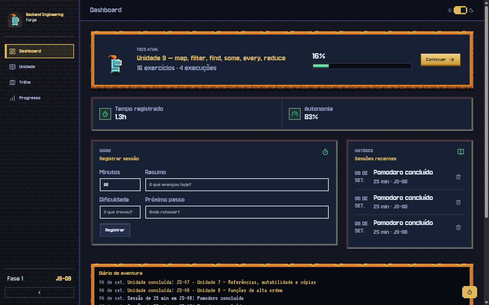
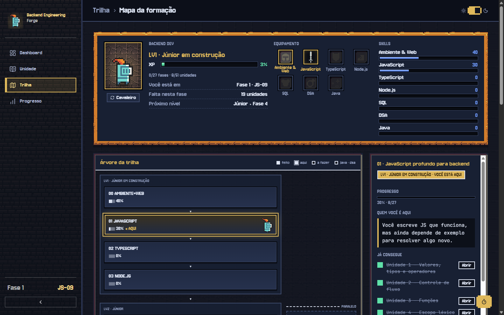
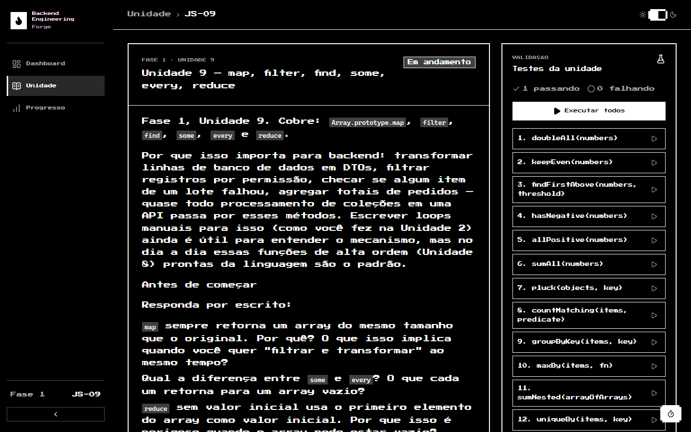
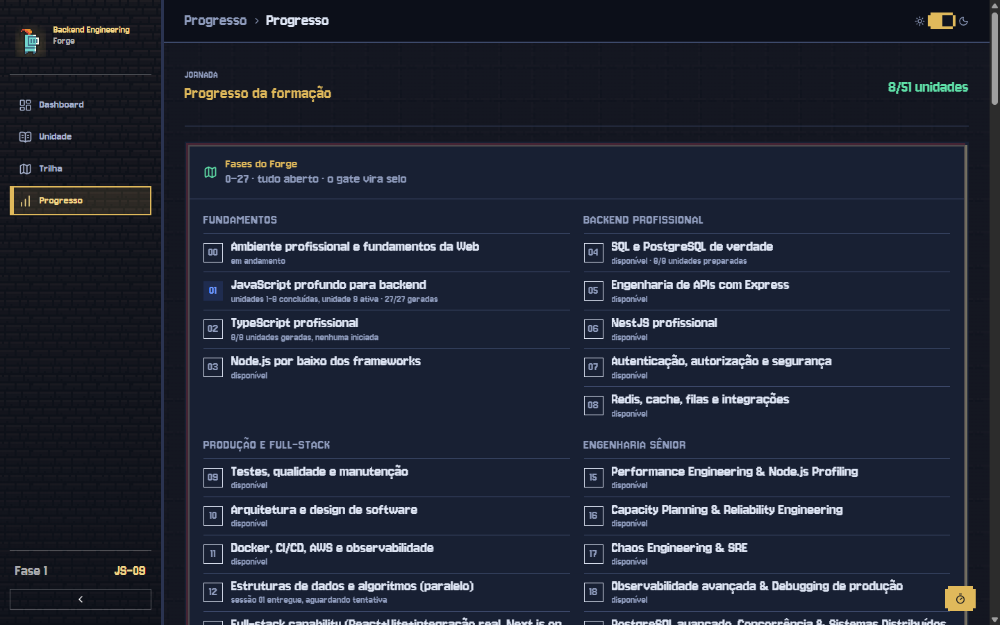
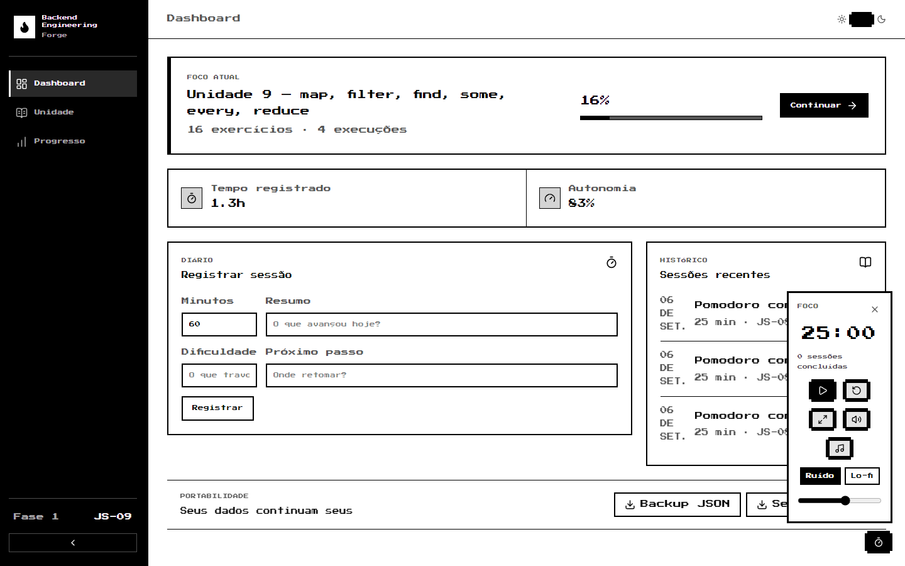
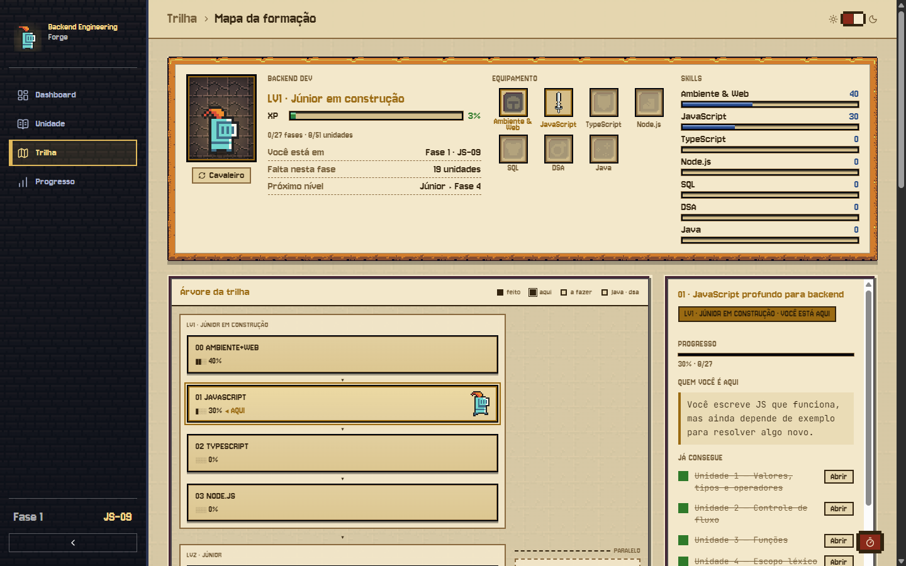
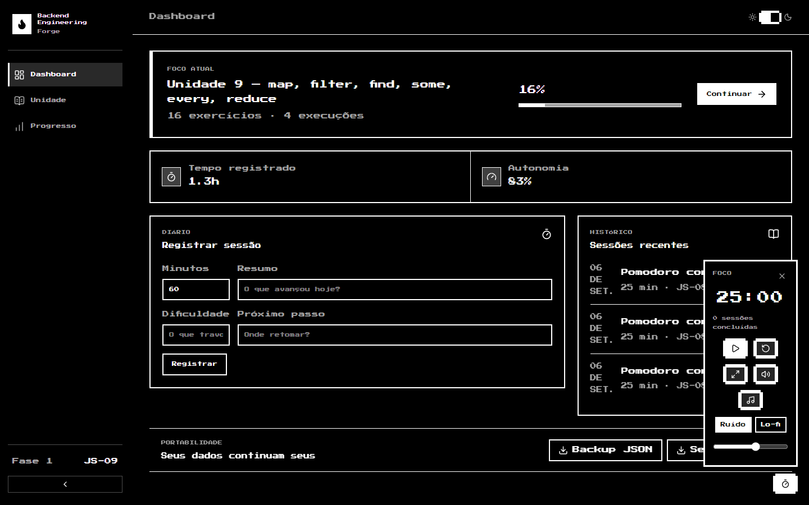
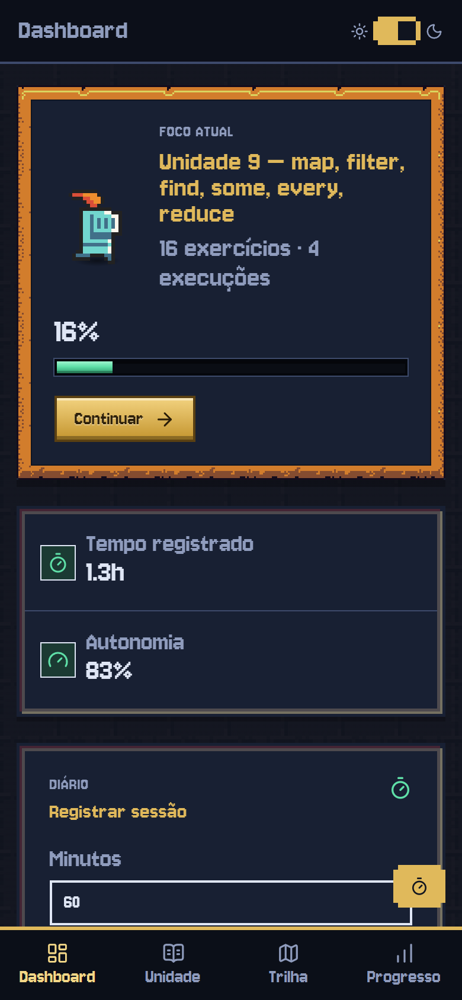
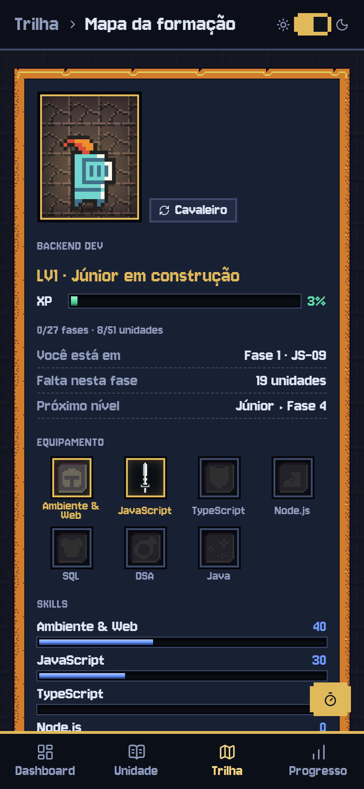

<div align="center">

# Backend Engineering Forge

Formação backend-first, orientada a projetos, com um painel local em estilo RPG
para acompanhar unidades, testes, dicas e revisões.




</div>

> Concluir esta trilha não transforma alguém automaticamente em
> desenvolvedor pleno. Senioridade também exige experiência real,
> responsabilidade em produção, colaboração e capacidade de lidar com
> problemas ambíguos. O objetivo é desenvolver competências técnicas e
> comportamentais compatíveis com um backend pleno.

## Sumário

- [O que é](#o-que-é)
- [Painel](#painel)
- [Estado atual](#estado-atual)
- [Como funciona uma unidade](#como-funciona-uma-unidade)
- [Como rodar](#como-rodar)
- [CLI](#cli)
- [Roadmap](#roadmap)
- [Arquitetura do painel](#arquitetura-do-painel)
- [Estrutura do repositório](#estrutura-do-repositório)
- [Stack](#stack)
- [Documentos de acompanhamento](#documentos-de-acompanhamento)
- [Créditos](#créditos)

## O que é

| | | |
| --- | --- | --- |
|  | **Currículo** | 28 fases (0–27), de JavaScript até confiabilidade e sistemas distribuídos. |
|  | **Exercícios com testes** | Cada unidade tem aula em Markdown, um `exercises.js` para implementar e um `exercises.test.js` que valida. |
|  | **Ferramentas locais** | CLI e painel web que registram sessões, rodam testes, liberam dicas, marcam progresso e agendam revisões. |

Divisão de tempo e ordem dos temas:

```text
80% backend e engenharia de software · 20% frontend para capacidade full-stack

JavaScript → TypeScript → Node.js → HTTP → PostgreSQL/SQL
→ API com framework leve → NestJS → autenticação/autorização/segurança
→ Redis, filas e integrações → arquitetura e qualidade
→ Docker, CI/CD, AWS e observabilidade → React/Vite + integração real → Tailwind CSS
→ projeto full-stack
```

Microsserviços, Kubernetes e frontend ficam para depois da base.

## Painel

Roda em `127.0.0.1`, sem conta, sem hospedagem e sem container. O visual
segue um cliente de MMORPG clássico: molduras, herói em pixel art,
equipamento por tecnologia e registro de eventos.

###  Trilha

Ficha do personagem com nível (LV1 Júnior em construção até LV4 Sênior), XP
da formação, slots de equipamento que acendem conforme você avança em cada
tecnologia e skills em porcentagem. Abaixo, a árvore das 28 fases, com o
herói no nó atual. Cada fase abre um painel com o perfil daquele estágio, o
que já foi feito, o que falta (com checkbox) e o perfil seguinte.



###  Unidade

Cada exercício é uma missão com objetivo, exemplo de entrada e saída,
regras, armadilhas, teste individual e três níveis de dica. A lista lateral
mostra o status de cada missão. O último grupo é o chefão da unidade.



###  Dashboard

Foco atual, tempo registrado, autonomia, registro de sessões, histórico de
unidades concluídas e exportação em JSON ou CSV. É a imagem do topo deste
arquivo.

###  Progresso

Todas as fases agrupadas por parte da formação, com status e unidades.



###  Temas, Pomodoro e celular

Tema escuro (ardósia e dourado) e tema claro (pergaminho). O Pomodoro
registra a sessão ao terminar e tem ruído e lo-fi embutidos. No celular, a
navegação fica na barra inferior.

| Dashboard no tema claro | Trilha no tema claro |
| --- | --- |
|  |  |



<p align="center">
  
  &nbsp;&nbsp;
  
</p>

Regras de progresso:

- Toda unidade, fase, projeto e a trilha Java ficam abertos. O progresso é
  marcado livremente.
- Gate é conquista, não bloqueio: suíte verde, reflexão de pelo menos 30
  caracteres e confiança 3 ou mais rendem um selo.
- Missão marcada à mão conta como feita e aparece como "marcada · sem teste
  verde".
- A classe do herói (Cavaleiro, Mago, Elfa, Lagarto) é escolhida na ficha.

## Estado atual

Retrato de 2026-11-09. O estado narrativo oficial fica em
[`PROGRESS.md`](PROGRESS.md) e as marcações do painel em `.forge/forge.db`.
Se este bloco divergir, valem essas fontes.

| Frente | Situação |
| --- | --- |
| Fase 0 — Ambiente e fundamentos da Web | Em andamento: repositório, lint, testes e painel prontos; tópicos conceituais pendentes |
| Fase 1 — JavaScript profundo | Em andamento: unidades 1–8 concluídas, unidade 9 (map/filter/reduce) ativa, 10–27 geradas |
| Fase 2 — TypeScript | Disponível: 8/8 unidades geradas |
| Fase 3 — Node.js | Disponível: 7 unidades preparadas |
| Fase 4 — SQL e PostgreSQL | Disponível: 8/8 unidades, ambiente Docker e Projeto 4 preparados |
| Fase 12 — DSA em paralelo | Em andamento: sessão 01 (Big O e arrays) entregue, aguardando tentativa |
| Project 01 — Order Workbench CLI | Concluído: 12/12 testes, retrospectiva e explicação oral |
| Project 04 — Marketplace Database Lab | Disponível: material preparado |
| Trilha poliglota (Java, .NET, Go) | Disponível: nenhuma selecionada |

Números:

- 51 unidades catalogadas (27 JS, 8 TS, 7 Node, 8 SQL, 1 DSA).
- 8/51 unidades concluídas; personagem em LV1, Fase 1, XP 3%.
- Suíte de sistema: 74/74 testes (`npm run test:system`).
- Autonomia: 83% (baseada no nível de dica revelado).

## Como funciona uma unidade

```text
ler a aula → responder as perguntas iniciais → resolver as missões
→ rodar o teste de cada missão ou a suíte → dica 1/2/3 só se travar
→ fechar a unidade com reflexão → revisar
```

- A unidade fecha com a suíte verde ou com todas as missões feitas. Fechar
  agenda revisões em 2, 7 e 30 dias.
- A autonomia registra o nível mais alto de dica revelada. Não é nota.

Regras completas do método e da mentoria em
[`LEARNING_CONTRACT.md`](LEARNING_CONTRACT.md).

## Como rodar

Requer Node.js 24 ou superior.

```bash
npm install
npm run forge:web
```

Abra `http://127.0.0.1:4310`. O banco SQLite é criado em `.forge/forge.db`
na primeira execução.

| Comando | Para quê |
| --- | --- |
| `npm run forge:web` | painel web local |
| `npm test` | testes da unidade ativa |
| `npm run test:unit -- js-02` | testes de uma unidade específica |
| `npm run test:system` | suíte das ferramentas do Forge |
| `npm run test:dsa` | sessão de DSA |
| `npm run test:project-01` | Project 01 — Order Workbench CLI |
| `npm run test:all` | tudo |
| `npm run forge -- <comando>` | CLI |
| `npm run lint` / `typecheck` / `format` | qualidade do código |
| `npm run build:web` | build do painel |
| `npm run sql:up` / `sql:down` / `sql:test` | PostgreSQL em Docker (Fase 4) |

## CLI

O que o painel faz também existe no terminal:

```bash
npm run forge -- status
```

```text
Backend Engineering Forge — status

Foco atual: Unidade 9 — map, filter, find, some, every, reduce (js-09)
Tempo total: 1.3h (75 min)
Unidades concluídas: 8/51
```

| Comando | O que faz |
| --- | --- |
| `status` | mostra o estado atual |
| `log` | registra uma sessão de estudo |
| `focus <js-02>` | define a unidade ativa |
| `test [js-02]` | executa os testes de uma unidade |
| `hint <1\|2\|3>` | revela uma dica progressiva |
| `progress` | lista todas as unidades |
| `review` | lista revisões agendadas |
| `next` | abre a próxima unidade |
| `export [json\|csv]` | exporta os dados |
| `import <json> --replace` | restaura um backup |

## Roadmap

```text
PARTE I   — Backend Foundations              (Fases 0-3)
PARTE II  — Professional Backend Engineering (Fases 4-8)
PARTE III — Production Backend Engineering   (Fases 9-14, até Pleno + full-stack capability)
PARTE IV  — Senior Backend Engineering       (Fases 15-27, após Pleno)
```

Sequência: Fundamentos, Backend Engineering, Backend Pleno, Full-stack
capability (React, Vite, TanStack Query, React Hook Form e Zod integrados à
API NestJS; Next.js como módulo opcional na Fase 13.6), Production
Engineering, Reliability Engineering, Distributed Systems e Senior Backend
Engineering.

A Parte IV cobre responsabilidade por sistemas em produção: performance,
confiabilidade, segurança, sistemas distribuídos, operação, incidentes,
arquitetura e liderança técnica. Tabela fase a fase em
[`ROADMAP.md`](ROADMAP.md); índice completo em
[`BACKEND_ENGINEERING_FORGE.md`](BACKEND_ENGINEERING_FORGE.md).

Trilha poliglota opcional: Java/Spring, C#/.NET ou Go podem ser ativados a
qualquer momento. TypeScript, Node.js e NestJS seguem como formação
principal, numa divisão de cerca de 70%/30% depois da escolha. Detalhes em
[`docs/tracks/POLYGLOT_BACKEND_TRACK.md`](docs/tracks/POLYGLOT_BACKEND_TRACK.md).

## Arquitetura do painel

```text
React local (Vite)
    │
    ▼
API Node/Express ─────── Markdown, missions.json e arquivos de teste
    │
    ├─────────────── execução permitida de node --test
    │
    ▼
SQLite local (.forge/forge.db)
```

O executor não aceita caminho vindo do navegador: a unidade é localizada no
currículo e o teste precisa estar dentro do workspace. O teste de uma
missão roda com padrão ancorado no nome do exercício. Detalhes em
[`docs/architecture/forge-web-local.md`](docs/architecture/forge-web-local.md).

## Estrutura do repositório

```text
exercises/      unidades por fase (01-javascript-core, 02-typescript-core,
                03-node-core, 04-sql-postgresql, 12-dsa-algorithms)
projects/       projetos progressivos (01-order-workbench-cli, 04-postgres-marketplace-lab)
labs/           laboratórios (http, database, node-runtime, queues, security, observability)
assessments/    gates de fase, code review, debugging, system design, mock interviews
solutions/      soluções de referência
notes/          anotações de estudo
docs/           currículo, trilha (trilha.json), arquitetura, ADRs, screenshots
tools/          forge-cli, forge-core, forge-sql, forge-web
.forge/         banco SQLite local com sessões e progresso (não versionado)
```

Mapa detalhado em [`docs/REPOSITORY_MAP.md`](docs/REPOSITORY_MAP.md).

## Stack

| Camada | Tecnologia |
| --- | --- |
| Runtime | Node.js 24, ES Modules |
| Testes | `node --test` |
| API do painel | Express 5 |
| Interface | React 19, Vite 8, Tailwind CSS 4, Radix UI, lucide-react |
| Visual | tema próprio, RPGUI, sprites 0x72, fontes Jersey 10 e VT323 |
| Persistência | SQLite local (`node:sqlite`) |
| Conteúdo | Markdown com front matter (`gray-matter`, `react-markdown`) |
| Qualidade | ESLint, Prettier, TypeScript |

## Documentos de acompanhamento

- [`PROGRESS.md`](PROGRESS.md) — estado narrativo e de mentoria.
- [`ROADMAP.md`](ROADMAP.md) — fases completas da formação.
- [`STUDY_LOG.md`](STUDY_LOG.md) — diário de sessões de estudo.
- [`SKILLS_MATRIX.md`](SKILLS_MATRIX.md) — estado de cada competência.
- [`LEARNING_CONTRACT.md`](LEARNING_CONTRACT.md) — regras do método e da mentoria.
- [`BACKEND_ENGINEERING_FORGE.md`](BACKEND_ENGINEERING_FORGE.md) — especificação da formação.
- [`docs/README.md`](docs/README.md) — índice da documentação.
- [`docs/REPOSITORY_MAP.md`](docs/REPOSITORY_MAP.md) — mapa curto para pessoas e agentes de IA.
- [`docs/architecture/forge-web-local.md`](docs/architecture/forge-web-local.md) — arquitetura do painel.

Comandos de mentoria (`INICIAR`, `PROXIMA_UNIDADE`, `SELECIONAR_TRILHA`,
`REVISAR`, `DICA_1/2/3`, `MOSTRAR_SOLUCAO`, `SIMULAR_BUG`, `SIMULAR_PR`,
`AVALIAR_FASE`, `GERAR_PROJETO` e outros) estão em
[`LEARNING_CONTRACT.md`](LEARNING_CONTRACT.md).

## Créditos

- Sprites: [16x16 DungeonTileset II](https://0x72.itch.io/dungeontileset-ii), por 0x72 (CC0).
- Molduras, barras e ícones de slot: [RPGUI](https://github.com/RonenNess/RPGUI), por Ronen Ness (Zlib).
- Ícones deste README: [Lucide](https://lucide.dev) (ISC).
- Fontes: Jersey 10 e VT323 (SIL Open Font License).

Detalhes em [`tools/forge-web/src/public/CREDITS.md`](tools/forge-web/src/public/CREDITS.md).
