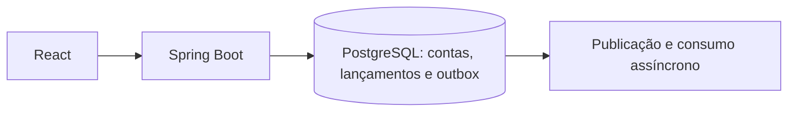

# LedgerFlow — carteira digital

Projeto central do Forge (Fases 4–11). Um único sistema que cresce a cada fase:
começa como API Spring Boot com contas e transferências e termina como uma
plataforma financeira com front React, auditoria, mensageria e deploy GCP com
observabilidade. O consumidor NestJS é uma extensão. Automação e RAG são praticados no [TicketAtlas](../11-ticketatlas/README.md).

Por que este domínio: sistemas financeiros obrigam a resolver o que entrevistas
Java cobram — transações ACID, concorrência (duas transferências ao mesmo
tempo), idempotência (não cobrar duas vezes), auditoria e segurança.

> Este README é catálogo. Código, enunciados detalhados e testes de cada marco
> são criados quando a fase anterior estiver perto do fim. Nenhuma solução é
> fornecida antes da tentativa.

## Domínio

- **Cliente** — dono de uma ou mais contas.
- **Conta** — saldo em centavos (`long`), nunca negativo.
- **Transação** — depósito, saque ou transferência; imutável depois de criada.
- **Extrato** — histórico paginado por conta, com categoria.
- **Tarifa** — regra aplicada a operações (fixa ou percentual).

Invariantes que o sistema precisa garantir do M1 em diante:

1. Saldo nunca fica negativo.
2. Transferência é tudo-ou-nada: débito e crédito na mesma transação.
3. A mesma requisição repetida (mesma `Idempotency-Key`) não duplica o efeito.
4. Toda movimentação deixa registro auditável.

## Marcos

| Marco | Fase | Entrega | Gate |
|---|---|---|---|
| M1 | 4 | API Spring Boot: contas, depósito, saque, transferência e extrato paginado. JPA + Flyway + PostgreSQL. Erros com `ProblemDetail`. | Testes de integração com Testcontainers verdes; transferência concorrente não quebra o invariante 1. |
| M2 | 5 | Login com JWT, papéis (cliente/admin), senhas com BCrypt. Dockerfile multi-stage e Compose. Primeiro deploy. | Endpoint protegido recusa token inválido; `docker compose up` sobe tudo do zero. |
| M3 | 7 | Cache de saldo e rate limit com Redis; evento `TransferCompleted` publicado via outbox; consumidor idempotente. Kafka para o fluxo de eventos, RabbitMQ para tarefas. | Evento reprocessado não duplica efeito; queda do consumidor não perde mensagem. |
| M5 (extensão) | 9 | Microsserviço de notificações em NestJS consumindo eventos da fila. | Mesmo evento entregue duas vezes gera uma notificação só. |
| M6 | 10 | Pipeline GitHub Actions, deploy no GCP (Cloud Run + Cloud SQL), logs estruturados, métricas e traces. | Deploy automático a cada merge; um erro em produção é rastreável do log ao trace. |
| M7 | 11 | ADRs, diagramas C4, README de portfólio com demo e roteiro de apresentação para entrevista. | Explicar a arquitetura e defender três decisões sem consultar anotações. |

O front React (Fase 6) inclui: login, saldo, extrato com filtros e
tela de transferência.

## Stack-alvo

Java 21+, Spring Boot 3, Spring Data JPA, Spring Security, PostgreSQL, Flyway,
JUnit 5, Mockito, Testcontainers, Redis, Kafka, RabbitMQ,
React + TypeScript + Vite, NestJS, Docker, GitHub Actions, GCP.

## Problema, requisitos e execução

Um usuário precisa movimentar fundos sintéticos, consultar extrato e entender
o resultado de uma tentativa repetida. Use Java 21+, Spring Boot, JPA,
PostgreSQL e Flyway para praticar limites transacionais e schema versionado.
React oferece uma segunda demonstração fullstack. Os pré-requisitos acima são
recomendações para começar no nível 1; a evolução financeira chega ao nível 3.

- **História e tarefa técnica** — como titular, quero transferir com recibo
  auditável. Modele a chave idempotente por solicitante e teste a atomicidade.
- **Requisitos não funcionais** — valores exatos em centavos, trilha auditável
  e latência medida sob concorrência com perfil documentado.
- **Modelo inicial** — Cliente 1:N Conta. Transferência tem lançamentos
  correlacionados; cada lançamento pertence a uma conta.

- **Casos de erro** — saldo insuficiente, conta indisponível, mesma chave
  com payload diferente, requisições simultâneas e falha após persistência.
- **Testes** — JUnit para invariantes e Testcontainers para constraints,
  isolamento, rollback, idempotência e reconciliação. Exercite o fluxo React.
- **Segurança** — autorização por titular, dados sintéticos, menor privilégio
  e logs sem token ou dado financeiro sensível.
- **Execução local** — o marco M2 deve documentar Compose para API e banco,
  configuração e migrations; acrescente a UI e o broker nos marcos que os usam.

## Desafio e aceitação

- [ ] Concorrência preserva saldo, débito/crédito conciliam e replay tem efeito único.
- [ ] Uma falha entre etapas deixa evidência rastreável e recuperação testada.
- [ ] Compose e testes funcionam em ambiente limpo.
- [ ] README em inglês inclui OpenAPI, diagrama, ADRs, demo e relatório de carga.
- [ ] A [rubrica](../README.md#rubrica-por-projeto) tem evidência por eixo e
  uma defesa de decisões sem IA.

Desafio individual: reconcilie o estado após interrupção da publicação e
defenda o limite entre o ledger local e um efeito externo. Em entrevista,
explique por que a idempotência do endpoint difere da do consumidor. Como
melhoria opcional, compare compensação por Saga para um efeito externo com
a transação local do ledger e documente quando a complexidade compensa.

## Entregas no semestre

Comece Java no dia 23. Pratique rollback e concorrência antes de publicar.
Nos dias 111–120, use Jenkins para validar testes Maven, gerar uma imagem por
commit e ensaiar rollback local. Nos dias 134–140, compare Spring AI com o
RAG do TicketAtlas em um laboratório com guias sintéticos e experimente um
job de reconciliação. Calcule os valores no Java e use IA para redigir o resumo.
Consulte a [matriz de cursos](../../docs/curriculum/course-matrix.md).
