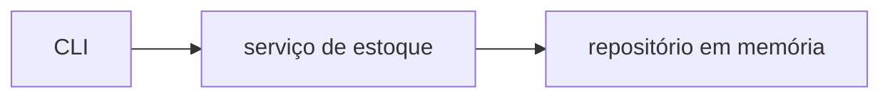

# Gestão de estoque em Java

Nível 0 · Preparação recomendada: java-03.

## Negócio e problema

Uma oficina precisa saber o que entrou, saiu e ficou abaixo do mínimo.

## Stack

Java 21+, Maven e JUnit para concentrar a prática no domínio.

## Requisitos

- Funcionais — Cadastrar itens, registrar movimentações e listar alertas de reposição.
- Não funcionais — Movimentações determinísticas e mensagens de erro legíveis.
- História e tarefa técnica — Como operador, quero retirar peças; modele a regra e valide a entrada da CLI.

## Modelo e arquitetura

CLI → serviço de estoque → repositório em memória; Item 1:N Movimento.

## Marcos

Cadastro → entradas/saídas → relatório e testes.

Entregue cada marco em um PR com um caso de aceitação executável. Demonstre a
mudança e registre uma decisão antes de iniciar o próximo marco.

## Desafio e casos de erro

- Desafio individual — Acrescente importação CSV com resumo de registros rejeitados.
- Casos a verificar — SKU repetido, quantidade inválida e retirada acima do saldo.

## Testes, segurança e ambiente local

- Testes — JUnit parametrizado para limites e teste da CLI com entrada simulada.
- Segurança — Valide entradas e limite caminhos se houver importação.
- Execução local — JDK 21+ e Maven; Docker opcional para execução reproduzível.

## Aceitação e conclusão

- [ ] Retirada rejeitada mantém saldo e histórico; relatório reflete o saldo final.
- [ ] Um ambiente limpo reproduz a execução e os testes documentados.
- [ ] Os casos de erro têm evidência e o estudante defendeu uma decisão sem IA.
- [ ] Artefatos de portfólio foram revisados e a rubrica preenchida.

Use a [rubrica do Forge](../README.md#rubrica-por-projeto) com os requisitos e
critérios acima.

## Entrevista, extensão e portfólio

- Entrevista — Quando Map melhora a busca por SKU?
- Extensão opcional — Persistência em arquivo com recuperação de falha.
- Portfólio — README em inglês, sessão de terminal e resultados do JUnit.

Brief de catálogo. Código inicial, exercícios e testes serão materializados
perto da prática.
