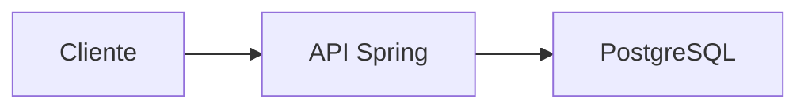

# API Comercial

Nível 1 · Preparação recomendada: java-03, sql-04.

## Negócio e problema

Um pequeno comércio precisa registrar pedidos sem vender além do estoque.

## Stack

Spring Boot, JPA/Hibernate, PostgreSQL, Flyway e Testcontainers para validar persistência real.

## Requisitos

- Funcionais — Gerir clientes e produtos, reservar estoque e consultar pedidos paginados.
- Não funcionais — Contrato OpenAPI estável e mudanças de schema versionadas.
- História e tarefa técnica — Como vendedor, quero fechar pedido; modele DTOs e defina o limite da transação.

## Modelo e arquitetura

Cliente → API Spring → PostgreSQL; Pedido 1:N ItemPedido; ItemPedido N:1 Produto.

## Marcos

Catálogo → pedidos/estoque → autenticação e publicação do contrato.

Entregue cada marco em um PR com um caso de aceitação executável. Demonstre a
mudança e registre uma decisão antes de iniciar o próximo marco.

## Desafio e casos de erro

- Desafio individual — Inclua cancelamento com devolução de estoque.
- Casos a verificar — Item indisponível, produto removido, página vazia e pedido inválido.

## Testes, segurança e ambiente local

- Testes — JUnit/Mockito na regra e Testcontainers para migration, transação e paginação.
- Segurança — Autorização por papel e recurso, validação e dados de demonstração sintéticos.
- Execução local — Compose para API e banco; documentar seed, health e teste Maven.

## Aceitação e conclusão

- [ ] Pedido rejeitado preserva estoque; instalação limpa aplica migrations; contrato cobre erros.
- [ ] Um ambiente limpo reproduz a execução e os testes documentados.
- [ ] Os casos de erro têm evidência e o estudante defendeu uma decisão sem IA.
- [ ] Artefatos de portfólio foram revisados e a rubrica preenchida.

Use a [rubrica do Forge](../README.md#rubrica-por-projeto) com os requisitos e
critérios acima.

## Entrevista, extensão e portfólio

- Entrevista — Como detectar N+1 e quais os custos de cada correção?
- Extensão opcional — Comparar paginação offset e cursor com EXPLAIN.
- Portfólio — README em inglês, diagrama, OpenAPI e teste de integração.

Brief de catálogo. Código inicial, exercícios e testes serão materializados
perto da prática.
