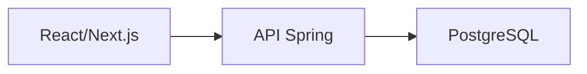

# SaaS de Agendamentos

Nível 2 · Preparação recomendada: API Comercial, fases 5–6.

## Negócio e problema

Um prestador de serviços precisa receber reservas e evitar sobreposição entre atendimentos.

## Stack

Spring Boot, PostgreSQL e React/Next.js para integrar um fluxo comercial de ponta a ponta.

## Requisitos

- Funcionais — Publicar disponibilidade, agendar, cancelar e administrar a agenda.
- Não funcionais — Fuso horário explícito, isolamento por organização e interface funcional no celular.
- História e tarefa técnica — Como cliente, quero reservar um horário; como administrador, quero limitar acesso à minha agenda.

## Modelo e arquitetura

React/Next.js → API Spring → PostgreSQL; Organização 1:N Recurso; Recurso 1:N Reserva.

## Marcos

Agenda → reserva concorrente → painel → deploy e entrega ao cliente.

Entregue cada marco em um PR com um caso de aceitação executável. Demonstre a
mudança e registre uma decisão antes de iniciar o próximo marco.

## Desafio e casos de erro

- Desafio individual — Remarcar uma reserva sob concorrência.
- Casos a verificar — Horário ambíguo, cancelamento repetido e duas reservas sobrepostas.

## Testes, segurança e ambiente local

- Testes — Testcontainers com concorrência e teste ponta a ponta do fluxo com React.
- Segurança — Verificar autorização entre organizações, proteger credenciais e limitar dados pessoais.
- Execução local — Compose para API, banco e UI; demo em Cloud Run quando viável.

## Aceitação e conclusão

- [ ] Duas reservas incompatíveis produzem um único sucesso; usuário de outra organização perde acesso ao recurso.
- [ ] Um ambiente limpo reproduz a execução e os testes documentados.
- [ ] Os casos de erro têm evidência e o estudante defendeu uma decisão sem IA.
- [ ] Artefatos de portfólio foram revisados e a rubrica preenchida.

Use a [rubrica do Forge](../README.md#rubrica-por-projeto) com os requisitos e
critérios acima.

## Entrevista, extensão e portfólio

- Entrevista — Como garantir exclusão mútua sem travar a agenda inteira?
- Extensão opcional — Lembretes e exportação de calendário.
- Portfólio — README em inglês, demo, roteiro de entrega e vídeo curto do fluxo.

Brief de catálogo. Código inicial, exercícios e testes serão materializados
perto da prática.
