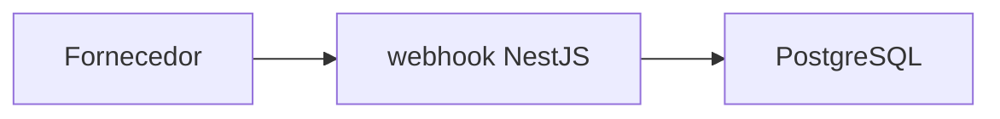

# Integrações Comerciais com NestJS

Nível 2 · Preparação recomendada: API Comercial, diagnóstico TS/Node.

## Negócio e problema

Uma operação comercial precisa sincronizar alterações de catálogo com fornecedores externos.

## Stack

NestJS com Fastify, TypeScript, ORM, PostgreSQL, Redis e Jest/Vitest para praticar integração e comparar contratos com Spring.

## Requisitos

- Funcionais — Receber eventos de fornecedor, registrar jobs, reprocessar falhas e expor histórico autenticado.
- Não funcionais — Timeouts explícitos, consumo limitado de recursos e correlação por integração.
- História e tarefa técnica — Como operador, quero reprocessar uma integração; implemente os estados do job e audite a ação.

## Modelo e arquitetura

Fornecedor → webhook NestJS → PostgreSQL; worker → API externa; Redis → cache/rate limit.

## Marcos

Webhook/contrato → job e retry → cache/rate limit → comparação com Spring.

Entregue cada marco em um PR com um caso de aceitação executável. Demonstre a
mudança e registre uma decisão antes de iniciar o próximo marco.

## Desafio e casos de erro

- Desafio individual — Troque o adaptador HTTP e meça o impacto num cenário representativo.
- Casos a verificar — Evento duplicado, resposta externa inválida, 429 e timeout.

## Testes, segurança e ambiente local

- Testes — Testes unitários de transição, integração com PostgreSQL/Redis e contrato com provedor simulado.
- Segurança — Validar assinatura e janela temporal, limitar entrada e manter segredos fora dos logs.
- Execução local — Compose para API, worker, banco, Redis e fornecedor simulado.

## Aceitação e conclusão

- [ ] Duplicata preserva o efeito único; reprocessamento é auditável; teste de contrato detecta quebra de schema.
- [ ] Um ambiente limpo reproduz a execução e os testes documentados.
- [ ] Os casos de erro têm evidência e o estudante defendeu uma decisão sem IA.
- [ ] Artefatos de portfólio foram revisados e a rubrica preenchida.

Use a [rubrica do Forge](../README.md#rubrica-por-projeto) com os requisitos e
critérios acima.

## Entrevista, extensão e portfólio

- Entrevista — Onde ficam DI, validação e transação em Spring e NestJS?
- Extensão opcional — Compare event loop lag antes/depois de isolar trabalho de CPU.
- Portfólio — README em inglês, ADR do adaptador HTTP e relatório de falhas/retries.

Brief de catálogo. Código inicial, exercícios e testes serão materializados
perto da prática.
