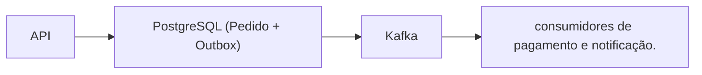

# Plataforma de Pedidos Orientada a Eventos

Nível 3 · Preparação recomendada: API Comercial e invariantes transacionais.

## Negócio e problema

Um comércio quer processar pagamentos simulados e notificações com tolerância a quedas.

## Stack

Spring Boot, PostgreSQL, Kafka e Redis onde a medição justificar cache; RabbitMQ em comparação para tarefas.

## Requisitos

- Funcionais — Emitir pedido, registrar pagamento simulado, atualizar estado e notificar.
- Não funcionais — Ordenação por pedido, recuperação de falha e latência observada.
- História e tarefa técnica — Como operador, quero recuperar pedidos após queda; registre eventos e implemente consumidor idempotente.

## Modelo e arquitetura

API → PostgreSQL (Pedido + Outbox) → Kafka → consumidores de pagamento e notificação.

## Marcos

Outbox → consumidores → retry/DLQ e replay → ADR sobre limites.

Entregue cada marco em um PR com um caso de aceitação executável. Demonstre a
mudança e registre uma decisão antes de iniciar o próximo marco.

## Desafio e casos de erro

- Desafio individual — Compare fila RabbitMQ com log Kafka usando o mesmo cenário.
- Casos a verificar — Queda antes do commit de offset, replay e evento atrasado.

## Testes, segurança e ambiente local

- Testes — Testcontainers com broker, teste de redelivery e verificação do estado final.
- Segurança — ACL de tópicos, dados sintéticos e escopo mínimo por consumidor.
- Execução local — Compose com API, broker, banco e consumidores.

## Aceitação e conclusão

- [ ] Replay mantém um único efeito de negócio; queda recupera backlog; DLQ mantém causa e correlação.
- [ ] Um ambiente limpo reproduz a execução e os testes documentados.
- [ ] Os casos de erro têm evidência e o estudante defendeu uma decisão sem IA.
- [ ] Artefatos de portfólio foram revisados e a rubrica preenchida.

Use a [rubrica do Forge](../README.md#rubrica-por-projeto) com os requisitos e
critérios acima.

## Entrevista, extensão e portfólio

- Entrevista — Qual garantia vem da chave de partição e qual vem da transação local?
- Extensão opcional — Compensação de pagamento ou projeção CQRS quando houver necessidade demonstrada.
- Portfólio — ADR, trace assíncrono e relatório de replay.

Brief de catálogo. Código inicial, exercícios e testes serão materializados
perto da prática.
