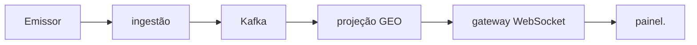

# Logística em Tempo Real

Nível 3 · Preparação recomendada: Plataforma de Pedidos e diagnóstico de concorrência.

## Negócio e problema

Uma operação de entregas precisa encontrar entregadores próximos e acompanhar status.

## Stack

Spring Boot, Kafka, Redis GEO e WebSocket; React opcional para visualizar a operação.

## Requisitos

- Funcionais — Receber localização, buscar proximidade e transmitir mudanças de status.
- Não funcionais — Definir limites de atraso, desconexão e volume de conexões a partir de um perfil de carga.
- História e tarefa técnica — Como despachante, quero ver posições recentes; modele timestamps e reconexão.

## Modelo e arquitetura

Emissor → ingestão → Kafka → projeção GEO → gateway WebSocket → painel.

## Marcos

Ingestão/projeção → reconexão → instrumentação → teste de carga; separar processos com justificativa.

Entregue cada marco em um PR com um caso de aceitação executável. Demonstre a
mudança e registre uma decisão antes de iniciar o próximo marco.

## Desafio e casos de erro

- Desafio individual — Compare Redis Pub/Sub com Streams para consumidores desconectados.
- Casos a verificar — GPS fora de ordem, posição expirada, conexão lenta e partição indisponível.

## Testes, segurança e ambiente local

- Testes — Testar reconexão, posição obsoleta, k6 e propagação de trace.
- Segurança — Autorizar assinatura por entrega, usar posições sintéticas e definir retenção.
- Execução local — Compose com broker, Redis, serviços e gerador de eventos.

## Aceitação e conclusão

- [ ] Cliente reconectado recupera estado coerente; mensagens antigas não revertem posições; relatório mede atraso.
- [ ] Um ambiente limpo reproduz a execução e os testes documentados.
- [ ] Os casos de erro têm evidência e o estudante defendeu uma decisão sem IA.
- [ ] Artefatos de portfólio foram revisados e a rubrica preenchida.

Use a [rubrica do Forge](../README.md#rubrica-por-projeto) com os requisitos e
critérios acima.

## Entrevista, extensão e portfólio

- Entrevista — O que muda quando a entrega de localização é mais rápida que o consumo?
- Extensão opcional — Comparar backpressure por descarte e por buffer limitado.
- Portfólio — Diagrama temporal, demo sintética e relatório de carga.

Brief de catálogo. Código inicial, exercícios e testes serão materializados
perto da prática.
