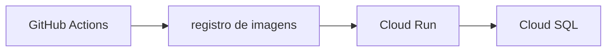

# Production Engineering Capstone

Nível 4 · Preparação recomendada: Um projeto instrumentado e com testes de integração.

## Negócio e problema

Um time precisa operar um sistema com metas de confiabilidade e recuperação verificáveis.

## Stack

GCP, Cloud Run, Cloud SQL, IAM, Secret Manager, GitHub Actions, Terraform, OpenTelemetry, Prometheus, Grafana e k6; GKE em laboratório comparativo.

## Requisitos

- Funcionais — Publicar revisão, observar tráfego, executar rollback e restaurar backup.
- Não funcionais — Definir SLO, orçamento de erro, RPO/RTO e limites de custo antes do ensaio.
- História e tarefa técnica — Como plantonista, quero diagnosticar degradação; instrumente SLIs, alertas e runbook.

## Modelo e arquitetura

GitHub Actions → registro de imagens → Cloud Run → Cloud SQL; OTel → telemetria; IaC → ambiente.

## Marcos

Baseline → pipeline e IAM → carga/rollback → restore, incidente e defesa.

Entregue cada marco em um PR com um caso de aceitação executável. Demonstre a
mudança e registre uma decisão antes de iniciar o próximo marco.

## Desafio e casos de erro

- Desafio individual — Compare Cloud Run, GKE e alternativas AWS/Azure por custo operacional; avalie Pub/Sub no domínio escolhido.
- Casos a verificar — Migration incompatível, saturação do pool, fila acumulada e backup inválido.

## Testes, segurança e ambiente local

- Testes — Smoke tests, carga controlada, verificação pós-rollback e restore em ambiente isolado.
- Segurança — Identidade de workload, menor privilégio, segredos gerenciados e logs sem dados pessoais.
- Execução local — Compose para desenvolvimento; IaC para ambiente de ensaio e remoção dos recursos ao final.

## Aceitação e conclusão

- [ ] Relatório mostra percentis, taxa de erro, capacidade, RPO/RTO medidos e timeline do incidente.
- [ ] Um ambiente limpo reproduz a execução e os testes documentados.
- [ ] Os casos de erro têm evidência e o estudante defendeu uma decisão sem IA.
- [ ] Artefatos de portfólio foram revisados e a rubrica preenchida.

Use a [rubrica do Forge](../README.md#rubrica-por-projeto) com os requisitos e
critérios acima.

## Entrevista, extensão e portfólio

- Entrevista — Quando escalar instâncias aumenta a pressão no banco?
- Extensão opcional — Canário e comparação JVM/Node com o mesmo perfil de carga.
- Portfólio — README em inglês, SLO, runbook, postmortem, ADR, HLD/LLD e demo gravada.

Brief de catálogo. Código inicial, exercícios e testes serão materializados
perto da prática.
